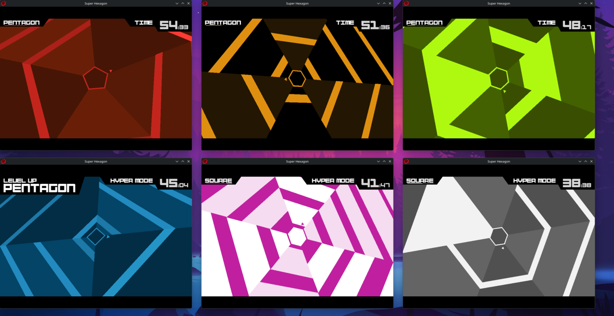
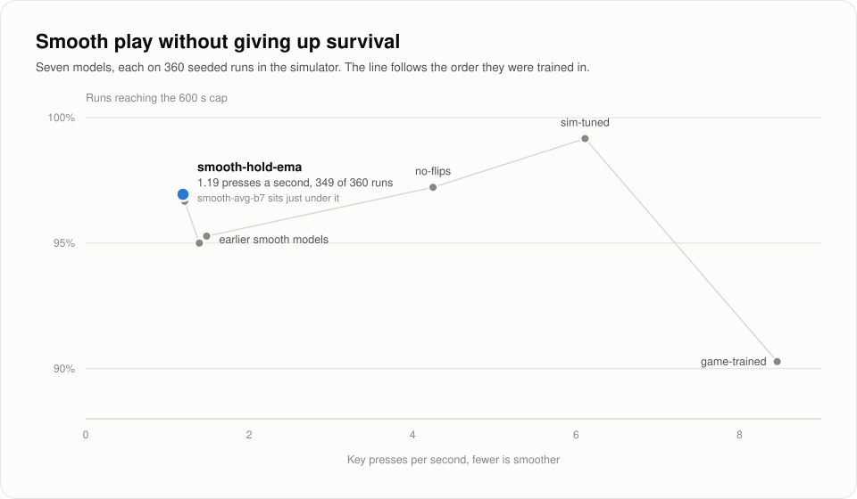
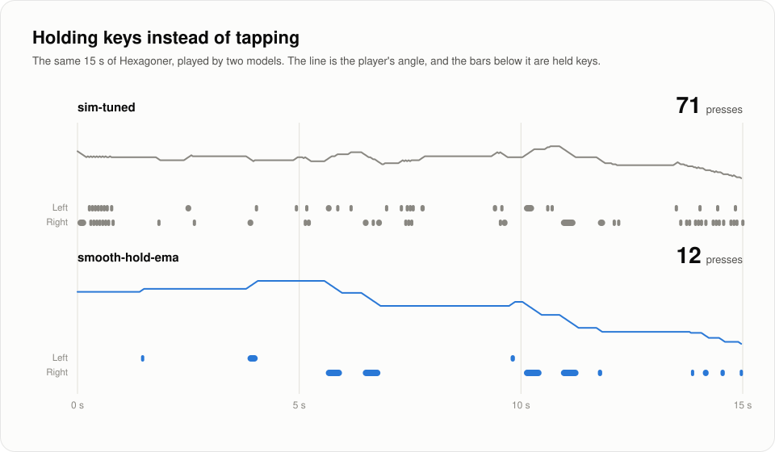

# Super Hexagon RL

A self learning agent for Super Hexagon. It reads the game's state from memory, trains with PPO in
a C simulator compiled from the game's own logic, and plays the real game in real time with real
key presses.



## Results

| Model | Real game | Simulator | Presses a second | Mean hold |
|---|---|---|---|---|
| `smooth-hold-ema` | 116 of 120 | 349 of 360 | 1.19 | 340 ms |
| `sim-tuned` | 120 of 120 | 357 of 360 | 6.11 | 81 ms |

Each count is runs that lasted the full 600 s, with 20 seeded runs per level on all six levels.
The real game column is one seed set, and the simulator column is three seed sets, played in a
simulator that matched the real game episode for episode each time it was checked. `sim-tuned` survives most but taps six times a
second, while `smooth-hold-ema` holds keys the way a person would.

<picture>
  <source media="(prefers-color-scheme: dark)" srcset="docs/figures/tradeoff-dark.svg">
  
</picture>

<picture>
  <source media="(prefers-color-scheme: dark)" srcset="docs/figures/movement-dark.svg">
  
</picture>

Played live on the game's own clock, `smooth-hold-ema` reached 600 s in 22 of 25 runs. The three
losses came from keys the game dropped when a window changed focus, which `play_live.py` now
catches, and it has lasted all 48 short runs since.

## How it works

- `hook/` is an `LD_PRELOAD` library that steps the game one tick at a time in lockstep with the
  agent, reads its state from memory, and fakes Steam so score uploads stay off.
- `sim/` compiles the game's gameplay functions, exported from Ghidra, into a library that runs
  hundreds of games at once, about four times faster than the real game.
- The agent sees 45 numbers, covering when the nearest walls in each of the six slots arrive and
  how long they last, its place in its slot, the side count, wall speed, level, and its last key
  and how long it's been held.
- `scripts/train_ppo.py` is a plain PPO with 256 unit actor and critic networks, 30 decisions a
  second, and a reward of -1 on death. Small costs on each new press and on reversals teach it to
  hold keys.

## Quick start

You'll need Super Hexagon on Steam as the native Linux build, gcc, Python 3.12, the system SDL2
(`sdl2-compat`), and an X11 or Xwayland session. The hook uses fixed addresses, so the scripts
refuse any binary whose SHA-256 isn't `6f13c58d136b84df212cc23a560f7383e2f689005af18072e51d8a7439d2ba1d`.

```bash
python3 -m venv .venv
```

```bash
.venv/bin/pip install -r env/requirements.txt
```

```bash
make -C hook
```

Watch the agent play a minute of Hexagoner:

```bash
.venv/bin/python scripts/eval_policy.py models/smooth-hold-ema.pt --watch --levels 1 --episodes 1 --max-seconds 60
```

Play live on the game's own clock (`--sound 2` adds music at volume 2 of 10):

```bash
.venv/bin/python scripts/play_live.py models/smooth-hold-ema.pt --levels 1 --episodes 1 --max-seconds 120 --sound 2
```

Run the standard evaluation, 20 seeded runs per level with a 600 s cap:

```bash
.venv/bin/python scripts/eval_policy.py models/smooth-hold-ema.pt --levels 0 1 2 3 4 5 --episodes 20 --max-seconds 600
```

Training and the fast evaluation (`scripts/eval_batch.py`) need the simulator, which you build from
your own Ghidra export of the game, as `decomp/README.md` explains. Then:

```bash
make -C sim
```

```bash
.venv/bin/python scripts/check_sim.py
```

```bash
.venv/bin/python scripts/train_ppo.py --backend sim --run-name example --init-model models/smooth-hold-ema.pt --lr 1e-4 --press-cost 0.0008 --reversal-cost 0.003 --level-target-seconds 600 --max-minutes 30 --snapshot-minutes 10
```

## Docs

- `docs/hook.md` covers the hook, the lockstep protocol, and the observation.
- `docs/simulator.md` covers the simulator and how it was checked against the game.
- `docs/training.md` covers every training run, what worked, and what didn't.
- `docs/live-play.md` covers live play, latency, and the dropped key fix.
- `models/README.md` lists every checkpoint, and `decomp/README.md` the reverse engineering notes.
- `scripts/plot_figures.py` draws the figures above from `docs/figures/models.json`.

## Notes

This project isn't affiliated with Terry Cavanagh, and it doesn't include the game, its code, or
its data. The decompiled functions, generated simulator sources, and state dumps stay on your
machine, and each game instance saves into its own folder under `runs/`, so your own save isn't
touched. The code is MIT licensed.
