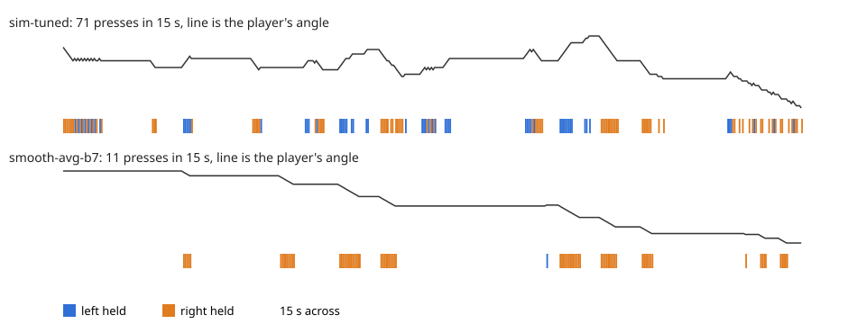

# Super Hexagon reinforcement learning

A reinforcement learning agent that plays Super Hexagon, Terry Cavanagh's game, on the native
Linux build. It reads the game's state from memory instead of the screen, trains with PPO in a C
simulator compiled from the game's own decompiled logic, and then plays the real game, either in
lockstep or live in real time with real key events.


## Results

Every count below is runs that reached a 600 s cap, with 20 seeded episodes per level across all
six levels (Hexagon through Hyper Hexagonest).

| Model | Real game | Three seed sets | Presses/s | Mean hold |
|---|---|---|---|---|
| `models/sim-tuned.pt` | 120 of 120 | 240 of 240 (two sets) | 5.7 to 6.1 | 81 to 85 ms |
| `models/smooth-hold-ema.pt` | 116 of 120 | 349 of 360 | 1.19 | 340 ms |

`sim-tuned.pt` survives the most, but it taps about six times a second. `smooth-hold-ema.pt` holds
keys the way a person would, and it's the one to watch. The seed set counts were played in the
simulator, which matched the real game episode for episode each time it was checked, and the real
game column is the first seed set played in the actual game.



Played live, with the game running on its own clock and the agent sending key events,
`smooth-hold-ema.pt` reached the cap in 22 of 25 runs, and 31,774 of its 31,777 key changes reached
the game in time for the next tick. All three losses were early in Hyper Hexagonest, which
`docs/live-play.md` looks into.

## How it works

- `hook/` is an `LD_PRELOAD` library for the game. It can take over the game's loop and step it
  one 1/60 s tick at a time in lockstep with the agent, reading the state from memory and writing
  key state directly. It also replaces the Steam API with local fakes, so scores and achievements
  are never uploaded.
- `sim/` compiles the game's own gameplay functions, exported from Ghidra, into a library that runs
  hundreds of games at once in one process. It starts from a dump of the real game's state and ran about
  four times faster than the real game pipeline (467,000 against 122,000 agent steps a second).
- The observation is 45 numbers: for each of the six slots around the player, the time until the
  nearest two walls arrive and how long they take to pass, plus the player's position within its
  slot, the side count, wall speed, level, last action, and how long that action has been held.
- `scripts/train_ppo.py` is a plain PPO with separate 256 unit actor and critic networks, a
  decision every 2 ticks (30 a second), gamma 0.995, and a reward of -1 on death. Small costs on
  each new key press and on straight left to right reversals teach it to hold keys, and a running
  average of the weights during training gives the final policy.
- `scripts/play_live.py` plays the real game live. The game runs on its own real time clock, the
  agent reads memory through `/proc`, and key events go straight to the game's window.

## Requirements

- Super Hexagon from Steam on Linux, as the native build (depot 221643) with Proton turned off for
  it. The hook uses fixed addresses, so the scripts check that the binary's SHA-256 is
  `6f13c58d136b84df212cc23a560f7383e2f689005af18072e51d8a7439d2ba1d` and refuse anything else.
- gcc, make, and Python 3.12 (the version it was built and tested with).
- The system SDL2 (`sdl2-compat`) for headless games, and an X11 or Xwayland session for windows
  and live play (`xdotool` finds the window).

## Setup

```bash
python3 -m venv .venv
```

```bash
.venv/bin/pip install -r env/requirements.txt
```

```bash
make -C hook
```

That's enough to evaluate and watch the models in the real game. Building the simulator needs your
own Ghidra export of the game's functions, which `decomp/README.md` explains. With those in
`decomp/`, build it and write the starting state it needs (this also checks it against the game):

```bash
make -C sim
```

```bash
.venv/bin/python scripts/check_sim.py
```

## Usage

Watch a model play a minute of Hexagoner in a window, in lockstep:

```bash
.venv/bin/python scripts/eval_policy.py models/smooth-hold-ema.pt --watch --levels 1 --episodes 1 --max-seconds 60
```

Play live, with the game on its own clock (add `--sound` for music and sound effects at full volume,
or `--sound 2` for a volume of 2 out of 10):

```bash
.venv/bin/python scripts/play_live.py models/smooth-hold-ema.pt --levels 1 --episodes 1 --max-seconds 120
```

Run the standard evaluation (20 seeded episodes per level, 600 s cap) in the real game, headless:

```bash
.venv/bin/python scripts/eval_policy.py models/smooth-hold-ema.pt --levels 0 1 2 3 4 5 --episodes 20 --max-seconds 600
```

Run the same evaluation in the simulator, all episodes at once:

```bash
.venv/bin/python scripts/eval_batch.py models/smooth-hold-ema.pt --seed 12345
```

Train in the simulator, starting from a checkpoint:

```bash
.venv/bin/python scripts/train_ppo.py --backend sim --run-name example --init-model models/smooth-hold-ema.pt --lr 1e-4 --press-cost 0.0008 --reversal-cost 0.003 --level-target-seconds 600 --max-minutes 30 --snapshot-minutes 10
```

Training runs, game instances, and logs go under `runs/`.

## Layout

| Folder | Contents |
|---|---|
| `hook/` | Preload library, shared memory protocol, shared game driving code |
| `sim/` | Simulator runtime, converter tools, and build files |
| `env/` | Python game clients, Gymnasium env, vector envs, starting save |
| `scripts/` | Training, evaluation, live play, checks, and benchmarks |
| `decomp/` | Reverse engineering notes on the game's internals |
| `docs/` | Design notes, training logs, and results |
| `models/` | Trained checkpoints, described in `models/README.md` |

## Docs

- `docs/stage1-hook-plan.md` designs the lockstep hook and measures its speed.
- `docs/simulator.md` covers the simulator and how it was checked against the game.
- `docs/training-log.md` has the first training runs and evaluations.
- `docs/overnight-log.md` covers the work towards smooth, held movement.
- `docs/hold-anneal-log.md` tests a hold time input, press cost annealing, and weight averaging.
- `docs/live-play.md` covers live play, latency, and what's still open.

## Notes

This project isn't affiliated with Terry Cavanagh. It doesn't include the game, its code, or its
data, so you need your own copy. The decompiled functions, the generated simulator sources, and
the state dump all stay on your machine, and `.gitignore` keeps them out of git. Each game
instance saves into its own folder under `runs/`, so your own save and scores aren't touched.

The code is under the MIT license, in `LICENSE`.
